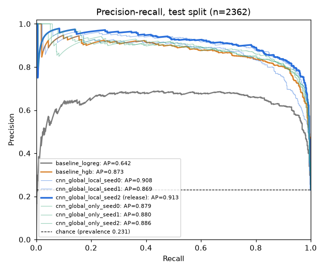
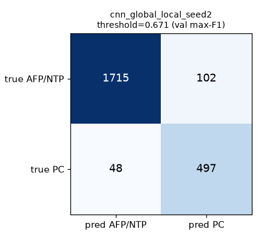
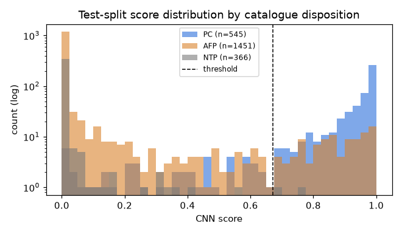
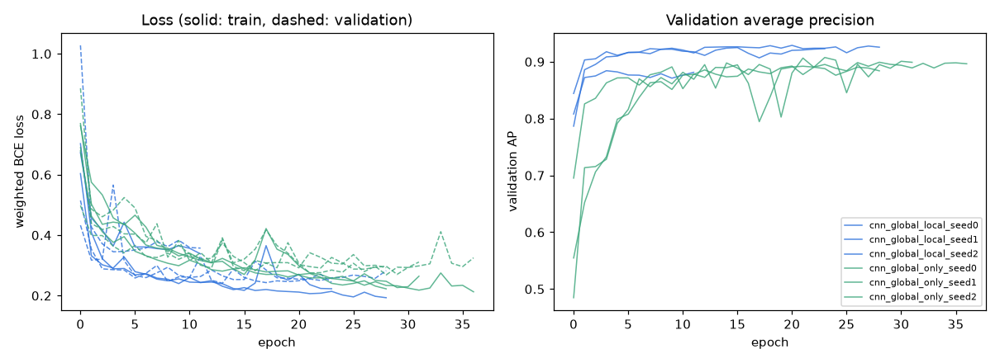
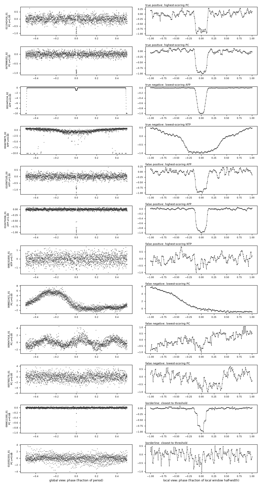

# Exoplanet Finder: results report (full experiment)

Every number here comes from files in this repository:
* `reports/full/metrics.json` and `reports/full/predictions.csv.gz` (per-example scores for every split and model)
* `reports/full/model_selection.json`, committed **before** test evaluation (commit `cd844af`)
* `reports/full/data_reconciliation.json`

The evaluation procedure was committed in [`EVALUATION_PROTOCOL.md`](EVALUATION_PROTOCOL.md) before training
(commit `074747a`). The auto-generated tables are in [`reports/full/RESULTS.md`](../reports/full/RESULTS.md).

## 1. What was measured

The task is **reproducing Kepler DR24 Autovetter training-set dispositions** (`av_training_set`): PC → 1,
AFP/NTP → 0, UNK excluded. The inputs are the candidate's light curve plus its period, epoch and duration. A high
score means "resembles DR24 planet candidates". It does not mean "is a planet".

## 2. Data

| | value |
|---|---|
| Labelled DR24 TCEs / stars | 15,737 / 9,865 (PC 3,600 · AFP 9,596 · NTP 2,541) |
| Stars downloaded from MAST | 9,865 of 9,865. 2 timed out in the first pass and succeeded on re-run; 0 final failures |
| Data transferred / time | 66.45 GB in 4.77 h (main pass, 12 workers) |
| Light-curve release | `DATA_REL = 25` for every file (labels are DR24) |
| Usable TCEs / stars | **15,733 / 9,861** |
| Excluded TCEs | 4, all training NTPs: low local coverage (2), insufficient in-transit points (1), low global coverage (1) |

| split | TCEs | stars | PC | AFP | NTP | prevalence |
|---|---|---|---|---|---|---|
| train | 11,010 | 6,900 | 2,518 | 6,656 | 1,836 | 0.229 |
| val | 2,360 | 1,479 | 536 | 1,489 | 335 | 0.227 |
| test | 2,362 | 1,481 | 545 | 1,451 | 366 | 0.231 |
| demo_holdout (Kepler-90) | 1 | 1 | 1 | 0 | 0 | — |

The splits are grouped by host star (seed 20171215), and no star appears in two splits; this is checked in code
and in tests.

## 3. Experiment configuration (`configs/full.yaml`)

* Preprocessing v1.0.0, fingerprint `7afac58f6d9539ec`. Settings: PDCSAP flux, default quality bitmask, gaps
  > 0.75 d split segments, cubic spline with 1.5 d knots and 3σ clipping (5 iterations), transit mask ±1.5 D, upward
  outliers > 5σ removed. Global view 2001 bins; local view 201 bins over ±4 D with bins 0.16 D wide.
* CNN: 5+2 conv blocks (filters 16-32-64-64-64 and 16-32, kernel 5, max-pool 5/2), FC 256-256 with dropout 0.3.
  Input channels are flux + coverage mask. 1,557,633 parameters (global-only: 1,155,201).
* Training: AdamW lr 1e-3, weight decay 1e-4, batch 128, ≤ 40 epochs, early stopping patience 8 on validation AP,
  `pos_weight` = 8,492 / 2,518 = 3.37, time-reversal augmentation (train only). Apple M5, PyTorch 2.15 on MPS.
* Baselines: 13 features. Logistic regression (median imputation + standardisation, balanced weights);
  `HistGradientBoostingClassifier` (300 iterations, learning rate 0.05, balanced weights).
* Thresholds: maximise F1 on validation. Release rule: highest validation AP among global+local CNN runs.

## 4. Every planned run

| run | best epoch / run | val AP | threshold | **test AP** | test ROC-AUC | test P / R / F1 | train time |
|---|---|---|---|---|---|---|---|
| baseline_logreg | — | 0.588 | 0.559 | 0.642 | 0.913 | 0.643 / 0.840 / 0.729 | < 1 min |
| baseline_hgb | — | 0.876 | 0.626 | 0.873 | 0.969 | 0.801 / 0.901 / 0.848 | < 1 min |
| CNN global+local seed 0 | 15 / 24 | 0.925 | 0.730 | 0.908 | 0.975 | 0.847 / 0.875 / 0.861 | 185 s |
| CNN global+local seed 1 | 3 / 12 | 0.884 | 0.602 | 0.869 | 0.963 | 0.826 / 0.818 / 0.822 | 88 s |
| **CNN global+local seed 2 (release)** | 20 / 29 | **0.929** | 0.671 | **0.913** | 0.977 | 0.830 / 0.912 / 0.869 | 209 s |
| CNN global-only seed 0 | 28 / 37 | 0.899 | 0.536 | 0.879 | 0.970 | 0.798 / 0.912 / 0.851 | 268 s |
| CNN global-only seed 1 | 20 / 29 | 0.892 | 0.492 | 0.880 | 0.969 | 0.782 / 0.927 / 0.848 | 202 s |
| CNN global-only seed 2 | 23 / 32 | 0.908 | 0.734 | 0.886 | 0.971 | 0.802 / 0.906 / 0.851 | 208 s |

All 8 planned runs were completed: 2 baselines, 3 global+local seeds and 3 global-only seeds. None are pending.

**Seed variation.** Global+local test AP is 0.897 ± 0.024 (sd over 3 seeds); global-only is 0.882 ± 0.004.
Seed 1 had a training-loss spike at epoch 4 (0.36 → 0.44) and never recovered. Early stopping ended it at epoch 11,
with a best validation AP of 0.884. The protocol was not changed after seeing this. A learning-rate schedule
or warm-up is a reasonable future change and would be tested as a new, separately labelled experiment.

**Global vs global+local.** Two of three global+local seeds (0.908, 0.913) beat every global-only seed (0.879–0.886).
The mean difference (+0.015 AP) is smaller than the global+local seed spread, so with 3 seeds the local view's benefit
is likely but not established. Global-only models were unstable on Kepler-90 h (scores 0.017, 0.490, 0.810), whose
331.6-day period makes each global bin ~4 hours wide, so its 14.5-hour transit spans only ~4 of 2,001 bins. This is the situation the local view
exists for.

## 5. Release model on the test split

`cnn_global_local_seed2`, threshold 0.671 (validation max-F1).

| metric | value |
|---|---|
| Test examples / stars | 2,362 / 1,481 (545 PC, 1,817 AFP+NTP; prevalence 0.231) |
| **Average precision** | **0.913** (95% star-bootstrap interval 0.886–0.939) |
| ROC-AUC | 0.977 |
| Precision / recall / F1 | 0.830 / 0.912 / 0.869 |
| Confusion matrix | TP 497 · FP 102 · TN 1,715 · FN 48 |
| Accuracy (secondary) | 0.936 |
| False-positive rate by disposition | AFP 6.9% (100 of 1,451) · NTP 0.5% (2 of 366) |
| vs gradient boosting | ΔAP = +0.041, 95% bootstrap interval [+0.013, +0.070] |

**Why accuracy is secondary.** A model that always answers "not PC" scores 0.769 accuracy with zero recall. AP
measures how well positives are ranked above negatives, and its chance level is the prevalence (0.231).

**Calibration.** Not performed. The test Brier score is 0.052; the score is reported as a ranking score, not a
probability.

## 6. Subgroups (release CNN, test split; tercile edges from training data)

| subgroup | n | PC | AP | recall | FPR |
|---|---|---|---|---|---|
| depth < 166 ppm | 760 | 97 | 0.878 | 0.876 | 0.032 |
| depth 166–662 ppm | 840 | 250 | 0.925 | 0.944 | 0.075 |
| depth ≥ 662 ppm | 762 | 198 | 0.908 | 0.889 | 0.066 |
| duration < 2.42 h | 770 | 140 | 0.868 | 0.829 | 0.041 |
| duration 2.42–4.81 h | 788 | 255 | 0.934 | 0.937 | 0.083 |
| duration ≥ 4.81 h | 804 | 150 | 0.919 | 0.947 | 0.049 |
| measured SNR < 18.8 | 817 | 89 | 0.850 | 0.820 | 0.027 |
| measured SNR 18.8–48.5 | 752 | 265 | 0.927 | 0.955 | 0.092 |
| measured SNR ≥ 48.5 | 793 | 191 | 0.917 | 0.895 | 0.061 |

The CNN is weakest on **low-SNR** and **short-duration** signals: fewer in-transit points means noisier views.
The gradient-boosting baseline drops further in the same subgroups (low-SNR AP 0.781, short-duration AP 0.821). The
CNN's largest advantage over the baseline is on deep signals (AP 0.908 vs 0.831), where shape information such as V vs
U and secondary eclipses matters most.

## 7. Error analysis (examples chosen by fixed rules, not by hand)

The scores, periods, depths and SNRs below are measured. The explanations started as hypotheses from looking at
the model's input views. They were then checked against **later-catalogue context**: the Kepler **DR25** KOI
vetting flags (NASA Exoplanet Archive `q1_q17_dr25_koi`; DR25 TCEs for the same stars from `q1_q17_dr25_tce`).
This changes no label, split, model or metric: the task remains reproducing **DR24** dispositions.

**How TCEs were matched.** A DR24 TCE is matched to a DR25 KOI only if the KOI is on the same star, has the same
period (within 0.1%), and its predicted transit times stay within half a DR24 transit duration of the TCE's
throughout the Kepler mission. Integer period ratios are recorded as aliases, never as matches. The rule,
per-example evidence (period ratio, phase offset, maximum separation), cached catalogue responses with SHA-256 and
retrieval time, and flag definitions are in
[`reports/full/dr25_koi_check/RESULTS.md`](../reports/full/dr25_koi_check/RESULTS.md). Regenerate it with
`python scripts/check_dr25_koi.py`. "DR25 disposition" below means `koi_pdisposition`, the uniform automated
DR25 vetting result. "Archive status" is shown only where verified independently of the KOI table. The Archive's
`keplernames` cross-ID table (KIC ID + KOI ID) gives the planet name. The default parameter set of the Planetary
Systems table (`ps`) must then be "Published Confirmed", with a matching period, and matching transit times when
that row gives them.

| DR24 TCE | DR24 label · CNN score | DR25 KOI match | DR25 disposition · flags | does it support the explanation? |
|---|---|---|---|---|
| `010587105_03` | AFP · 0.999 | K00339.03 | CANDIDATE, no FP flags; archive: CONFIRMED (Kepler-529 d) | **no** |
| `010470206_01` | AFP · 0.996 | K00335.01 | FALSE POSITIVE · Centroid Offset | **yes** |
| `008822421_01` | PC · 0.000 | K06188.01 | FALSE POSITIVE · Not Transit-Like (`SWEET_NTL`) | **partly** |
| `009047416_01` | PC · 0.000 | unresolved (same-period KOI K05605.01, epoch only within uncertainties) | — | unresolved |
| `005785279_01` | PC · 0.000 | unresolved (same-period KOI K04259.01 drifts 1.9 h) | — | unresolved |
| `008231830_01` | NTP · 0.771 | unresolved (no DR25 KOI or TCE on the star) | — | unresolved |
| `002445134_02` | AFP · 0.000 | unresolved (no KOI for this TCE) | related KOI: FALSE POSITIVE · Stellar Eclipse, `HAS_SEC_TCE` | unresolved, indirect support |
| `004678875_02` | NTP · 0.000 | unresolved (only KOI is at 3× the period) | related KOI: FALSE POSITIVE · Stellar Eclipse, `SWEET_EB` | unresolved, points elsewhere |
| `006611330_01` | PC · 0.676 | K01691.01 | FALSE POSITIVE · Stellar Eclipse (`DEEP_V_SHAPED`) | context only |

* **High-scoring AFPs.** The hypothesis was that their AFP labels rest on evidence the model never sees, such as
  centroid shifts. The evidence is **mixed**:
  * `010470206_01` (0.996): DR25 marks it a false positive with the **Centroid Offset** flag, i.e. the signal
    comes from a nearby star. This **supports** the hypothesis; a light curve alone cannot show it.
  * `010587105_03` (0.999): DR25 lists it as a **candidate with no false-positive flags**. The Archive's
    Planetary Systems table lists it as the confirmed planet Kepler-529 d (cross-ID K00339.03 → Kepler-529 d; the
    default parameter set, from Valizadegan et al. 2022, gives no transit epoch, so only the period was compared:
    35.8662 vs 35.8656 d). This **does not support** the hypothesis. Instead, the later
    catalogue disagrees with the DR24 AFP label, and the CNN's high score agrees with the later catalogue. We did
    not investigate why DR24 labelled it AFP.
* **Low-scoring PCs.** These show large residual stellar variability after detrending (measured SNR 9.5, 6.5 and
  11 for `008822421_01`, `009047416_01`, `005785279_01`; the last is a 66 ppm signal). The hypothesis was a
  detrending or SNR failure rather than a shape-learning failure.
  * `008822421_01`: DR25 marks it a false positive, **Not Transit-Like**, with `SWEET_NTL`: a sinusoid at the
    TCE period larger than the dip. This **partly supports** the hypothesis, since DR25 also attributes the signal
    to variability. But DR25 calls the signal itself not transit-like, so under the later catalogue the low score is
    agreement, not a detrending failure.
  * `009047416_01` and `005785279_01` are **unresolved**. Each star has one same-period KOI (both DR25 candidates
    without false-positive flags), but the epochs agree only within large uncertainties. KOI flags do not test
    detrending in any case, so the hypothesis remains unverified.
* **High-scoring NTP** `008231830_01` (0.771): a 55 ppm, SNR 11.5 signal. Hypothesis: mostly noise, with a
  chance dip near phase 0 looking transit-like. **Unresolved**: the star has no DR25 KOI and no DR25 TCE at all.
  The signal not being detected again in DR25 is consistent with a spurious signal, but it is not vetting
  evidence.
* **Correct rejections.**
  * `002445134_02`: its global view shows a deeper eclipse at phase ±0.5 than at phase 0, suggesting it is the
    secondary eclipse of an eclipsing binary. No DR25 KOI matches it (**unresolved**), but the indirect evidence
    is consistent. The star's only KOI, K05983.01, has the same period at the opposite phase (offset +0.499) and is
    a false positive with the **Stellar Eclipse** flag and `HAS_SEC_TCE`. The star's only other DR25 TCE has
    exactly this TCE's ephemeris, so it is the signal the DR25 Robovetter identified as that eclipse's secondary.
  * `004678875_02` (0.63-day smooth, wide dip): the hypothesis was stellar variability. **Unresolved**: no DR25
    KOI or TCE exists near 0.626 d. The star's only KOI, K03664.01, has **exactly 3×** this period (1.879 d) and
    is a false-positive eclipsing binary (Stellar Eclipse flag, `SWEET_EB`). The signal is more plausibly a
    1/3-period harmonic of that binary than independent variability, but this is not verified.
* **Borderline** cases at score 0.676 include `006611330_01`, a deep (7,000 ppm), short DR24 PC whose local view
  is asymmetric. No explanation was proposed. As context, DR25 classifies it as a false positive with the
  **Stellar Eclipse** flag (`DEEP_V_SHAPED`), so the later catalogue disagrees with its DR24 PC label.

**What this means for the metrics.** Three of the nine examples above (`010587105_03`, `008822421_01`,
`006611330_01`) have DR24 labels that DR25 later contradicts. Some test "errors" may therefore be label
disagreements rather than model errors. We did **not** re-score the test set against DR25: all metrics remain
measured against DR24 labels, as specified in the evaluation protocol.

## 8. Kepler-90 demonstration (decided before training; frozen model)

| signal | catalogue status | release CNN score | above 0.671? | HGB baseline |
|---|---|---|---|---|
| Kepler-90 h, DR24 TCE `011442793_01` | DR24 label PC; DR25 KOI K00351.01 is a DR25 **FALSE POSITIVE** (stellar-eclipse flag); the Archive's Planetary Systems table lists it as a confirmed planet (Archive name KOI-351 h) | **0.982** | yes | 0.523 (below 0.626) |
| Kepler-90 i, P = 14.44912 d, T₀ = BJD 2455644.3488, D = 2.80 h | Validated planet (Shallue & Vanderburg 2018, FPP ≈ 0.005); **not a DR24 TCE** | **0.987** | yes | not computed |

Later-catalogue context for Kepler-90 h: DR25's automated vetting flagged a significant secondary event
(`MOD_SEC_DV`, `MOD_SEC_ALT`) and labelled it a false positive, yet the Archive lists it as a confirmed planet. DR25's
automated dispositions are therefore not ground truth either. Kepler-90 i has no DR25 KOI with a matching
ephemeris (the match is unresolved). Its confirmed status is verified in `ps` against the ephemeris used here.

Kepler-90 i's measured local-view depth is about 116 ppm with SNR ≈ 13 from 74 observed transits. The CNN score says
its folded signal resembles DR24 planet candidates. That agrees with, but does not independently re-establish,
the published validation.

## 9. Comparison with Shallue & Vanderburg (2018)

The paper reports test AUC 0.988 and accuracy 0.960 (threshold 0.5) for a 10-model ensemble on a **random TCE-level**
split. Our single model reaches test ROC-AUC 0.977 on a **star-grouped** split, with different light curves
(DR25), preprocessing and a smaller network. These differences go in both directions, so we make **no claim** that our
model is better or worse than AstroNet.

## 10. Limitations and pending work

* Labels are DR24 dispositions, with known errors, not ground truth.
* There is no calibration and no ensemble. Three seeds show non-trivial variance (sd 0.024 AP).
* Transits of other planets in multi-planet systems are not removed.
* Detrending leaves residual short-time-scale variability, a source of false negatives.
* Not done: a blind period search, probability calibration, a learning-rate schedule experiment, multi-class
  (PC/AFP/NTP) training, and evaluation on DR25 labels or TESS data.
