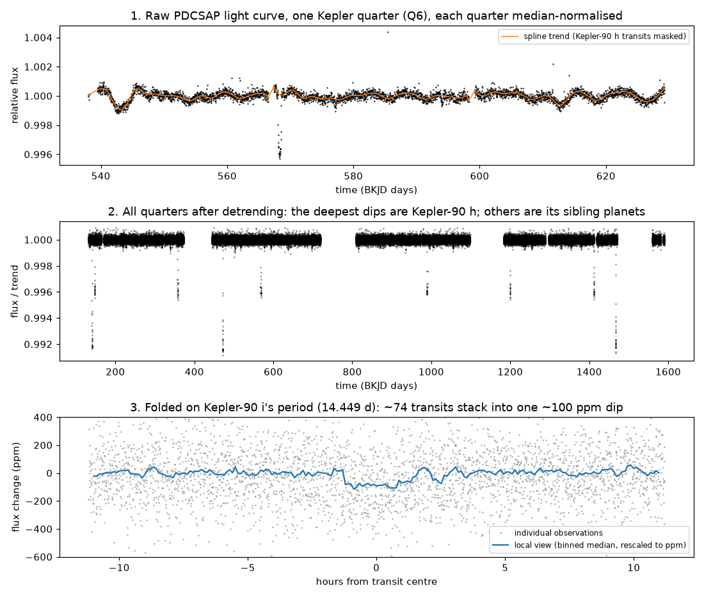
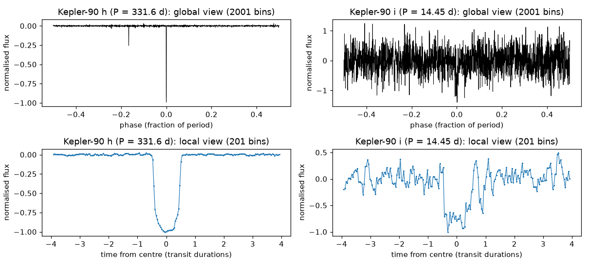

# A beginner's walkthrough of Exoplanet Finder

This guide explains every idea the project relies on, using real numbers from this implementation.
You do not need an astronomy background. Code references point to `src/exofinder/`.

---

## 1. Light curves: a star's brightness over time

Kepler stared at one patch of sky for four years and measured the brightness of each target star every
**~29.4 minutes** ("long cadence"). One star's list of `(time, brightness)` pairs is its **light curve**.

* **Time** is stored as **BKJD**: Barycentric Julian Date minus 2,454,833 days. "Barycentric" means the time
  is corrected to the centre of mass of the Solar System, so light-travel delays as Kepler orbits the Sun do not
  smear the signal. BKJD 0 is midday on 1 January 2009 (UTC). Kepler data span roughly BKJD 120–1590.
* **Brightness** is `PDCSAP_FLUX`, in electrons per second, after NASA's pipeline removed many spacecraft
  systematics. We divide each quarter (Kepler rotated every ~93 days, so each quarter lands on different pixels)
  by its median, giving a **relative flux** around 1.0.
* Some cadences are unreliable (thruster firings, safe mode, cosmic rays on the detector). Each has a
  `SAP_QUALITY` bit flag. We drop cadences flagged by Lightkurve's default bitmask (`lightcurve.py`).

For Kepler-90 (KIC 11442793) the archive provides 14 quarters with 51,503 good cadences. Quarters 0, 8, 12 and 16 are
absent. The once-a-year pattern is what you would expect if Kepler's seasonal roll placed the star on CCD module 3,
which failed in January 2010.



## 2. Transits

If a planet's orbit is edge-on to us, it blocks a little starlight once per orbit. The fractional dip is roughly
`(R_planet / R_star)²`: about **84 ppm** (parts per million) for an Earth around a Sun-like star and ~1% for
Jupiter. A transit is described by:

| quantity | meaning | DR24 column | unit |
|---|---|---|---|
| period *P* | time between transits | `tce_period` | days |
| epoch *t₀* | centre of one transit | `tce_time0bk` | BKJD days |
| duration *D* | first to last contact | `tce_duration` | **hours** (converted to days ÷24) |

Kepler-90 h has *P* = 331.6 d and *D* = 14.5 h; our pipeline measures a depth of ≈ 8,300 ppm. Only 3 of its
transits fall inside the observed data.

## 3. Why many dips are not planets

NASA's pipeline flagged 20,367 repeating dips in the DR24 search as **Threshold Crossing Events (TCEs)**. Human
vetters and the Autovetter labelled a training subset as:

* **PC** (3,600) — planet candidate: looks like a planet transit after vetting.
* **AFP** (9,596) — astrophysical false positive: usually an **eclipsing binary** (two stars eclipsing each other),
  sometimes a background binary blended with the target, or light contamination.
* **NTP** (2,541) — non-transiting phenomenon: instrumental artefacts, stellar spots or pulsations.
* **UNK** (4,630) — unknown; we **exclude** these rather than guess.

The task here is therefore *"reproduce DR24's PC vs. not-PC labels"*. A PC is **not** a confirmed planet, and
the labels contain mistakes. Our model can only be as right as these labels.

## 4. Detrending: removing the star's own wiggles

Stars brighten and dim slowly (spots rotating, pulsations), often by more than a small transit. In panel 1 above
the orange curve is a **cubic spline**: a smooth curve made of cubic pieces joined at "knots" every 1.5 days.
Dividing the flux by this curve flattens it to ≈1 (panel 2).

Two safeguards keep the transit:

1. **Mask the transit** while fitting. Points within ±1.5 durations of each predicted transit are ignored by the
   spline, so it cannot bend down into the dip and erase it. The AstroNet paper describes the same idea, although
   its public preprocessing script fits the spline without a mask. `tests/test_preprocess.py` checks that an
   injected synthetic transit keeps its depth.
2. **Only clip upward outliers.** Points far *above* the trend (cosmic-ray hits, flares) are removed; points below
   it are never removed, because a transit *is* a downward outlier.

Gaps longer than 0.75 days split the light curve into separately-fitted segments, so the spline never bridges
missing data.

## 5. Phase folding: stacking transits

If the period is right, every transit happens at the same **phase**:

```
phase = ((t − t₀ + P/2) mod P) − P/2        (days, between −P/2 and +P/2)
```

All transits land at phase 0. Kepler-90 i's single transits (~100 ppm) are buried in ~180 ppm noise per
point, but its 74 observed transits stack: noise averages down roughly as 1/√N and a dip appears (panel 3). This is
also why **the period, epoch and duration must be supplied**: with wrong values the transits do not line up and
there is nothing to classify.

## 6. Global and local views

A neural network needs fixed-size inputs, but periods range from hours to hundreds of days. Following AstroNet, we
**bin** the folded curve into two fixed-length vectors, taking the median flux in each bin:

* **Global view**: 2001 bins covering the *whole orbit*. It shows things away from the transit: a **secondary
  eclipse** at phase ±0.5 is a strong sign of an eclipsing binary.
* **Local view**: 201 bins covering ±4 transit durations around the transit. Each bin is 0.16 durations wide,
  so neighbouring bins overlap. It shows the transit's *shape*: planets tend to make U-shaped dips with sharp
  edges, while grazing eclipsing binaries make V shapes.



**Normalisation.** Let *m* be the median of the local view and *s* = *m* − min(local view), the measured depth.
Both views become `(view − median) / s`. The out-of-transit level is then 0 and the transit bottom is −1, so the network
compares *shapes*, not raw sizes. Using the same *s* for both views keeps a secondary eclipse's depth relative to the
primary. If *s* is tiny (a flat light curve), the candidate is **rejected** rather than divided by ~0.

**Empty bins.** If no data fall in a bin, we fill it by interpolating its neighbours and record a 0 in a second
**coverage-mask** channel, so the network can tell real flux from interpolation. Candidates with too little coverage
(< 50% local or < 30% global) or fewer than 3 in-transit points are rejected with a stated reason.

## 7. The 1D convolutional neural network

A **1D convolution** slides a short filter (5 bins wide) along the view and responds to local patterns such as
an edge or a dip. Stacking layers with **max-pooling** (keeping the largest value in each window of 5, stepping by 2)
builds detectors for bigger patterns from smaller ones.

```
global view (2 × 2001) ─▶ 5 blocks [conv5 → ReLU → conv5 → ReLU → maxpool5/2]
                          channels 16, 32, 64, 64, 64  →  64 × 59 = 3,776 features
local view  (2 × 201)  ─▶ 2 blocks, channels 16, 32     →  32 × 48 = 1,536 features
concatenate (5,312) ─▶ Linear 256 → ReLU → Dropout 0.3 → Linear 256 → ReLU → Dropout 0.3 → Linear 1
```

That's 1,557,633 trainable parameters (`model.py`), about 92% of them in the fully connected head. The output logit goes
through a sigmoid to give a **score** between 0 and 1. We do **not** call it a probability: we never calibrated it.

## 8. Class imbalance

Only about 23% of labelled TCEs are PC. A lazy model that always answers "not PC" would be **77% accurate** and
useless. So:

* the loss weights each positive example by *n*<sub>neg</sub>/*n*<sub>pos</sub> (computed on training data only),
* we choose checkpoints by **average precision (AP)**, the area under the precision–recall curve, where a random
  model scores ≈ the prevalence (0.23), not 0.5,
* we report precision, recall and F1 at a threshold chosen on validation data, and accuracy only as a secondary number.

*Precision* = of the signals we called PC, the fraction that were PC. *Recall* = of the real PCs, the fraction
we caught.

## 9. Leakage, and why we split by star

**Leakage** means information from the test set sneaks into training, making results look better than they are.
One star can host several TCEs. They share the same noise, systematics and stellar variability, and an eclipsing
binary often produces two TCEs (primary and secondary eclipse). If one went to training and its sibling to test,
the model could "recognise the star" instead of learning transit physics.

So the split is **by host star** (`splits.py`): all of a star's TCEs go to the same split. 70% of stars train, 15%
validate (choose epochs and the threshold) and 15% test (touched once, at the end). The split is saved in
`data/splits/split_manifest.csv` with its seed and never regenerated. The original AstroNet split was random by
TCE, which is one reason our numbers are not directly comparable to the paper's.

Other leakage guards:
* No catalogue columns (disposition, Autovetter scores, catalogue SNR or depth) enter the model; it sees only the
  light curve and the candidate's period, epoch and duration.
* Augmentation (time-reversal: flipping both views left↔right, which keeps the transit centred) is applied only
  to training examples.
* Kepler-90 was removed from all splits *before* training so the demo is honest about never having seen it.

## 10. The baseline

To show that the CNN earns its complexity, `baseline.py` trains two scikit-learn models on 13 hand-made features
(depth, noise, SNR, duty cycle, odd/even depth difference, secondary-eclipse depth, transit shape, coverage). Odd/even
difference matters because an eclipsing binary with twice the reported period shows alternating eclipse depths.
All scaling is fitted on the training split.

## 11. What the score means and doesn't mean

A score above the threshold says: *"this folded signal looks more like DR24's planet candidates than its false
positives."* It does not check pixel-level centroid shifts, nearby contaminating stars, or radial velocities, which
are what astronomers use to confirm a planet. Kepler-90 i itself was **statistically validated** by Shallue &
Vanderburg using such additional analyses, not by the CNN score alone.

## 12. What happened when we ran it

* The full set covered 15,733 usable candidates from 9,861 stars. Training took 1.5–4.5 minutes per CNN on a laptop GPU (Apple M5).
* On 2,362 test candidates from 1,481 never-seen stars, the released CNN reached **AP 0.913**. A random ranking would
  score ≈ 0.23. The gradient-boosting baseline reached 0.873 and logistic regression 0.642.
* Three identical CNN set-ups with different random seeds scored 0.908, 0.869 and 0.913. Random initialisation alone
  moves results this much, which is why reporting one lucky run would be misleading.
* Kepler-90 h scored 0.982 and Kepler-90 i 0.987 (threshold 0.671). The global-only models gave Kepler-90 h scores
  of 0.017, 0.490 and 0.810: in a 2001-bin view of a 331-day orbit, its transit is only ~4 bins wide. That is the
  problem the local view solves.
* Typical mistakes: AFPs that look like perfect transits, and real candidates on very variable stars, where
  detrending could not flatten the light curve. Checking a few against the later DR25 catalogue gave mixed answers.
  One high-scoring "false positive" was flagged there for a centroid offset: the signal comes from a neighbouring
  star, which the model cannot see. Another is a DR25 candidate, now the confirmed planet Kepler-529 d. And the
  lowest-scoring PC was later flagged as not transit-like (sinusoidal variability), so catalogue labels can disagree
  ([details](RESULTS_REPORT.md#7-error-analysis-examples-chosen-by-fixed-rules-not-by-hand)).

Full numbers, figures and error analysis: [RESULTS_REPORT.md](RESULTS_REPORT.md).
