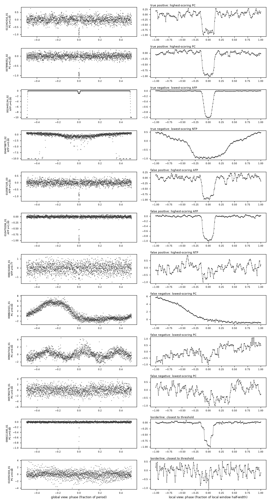
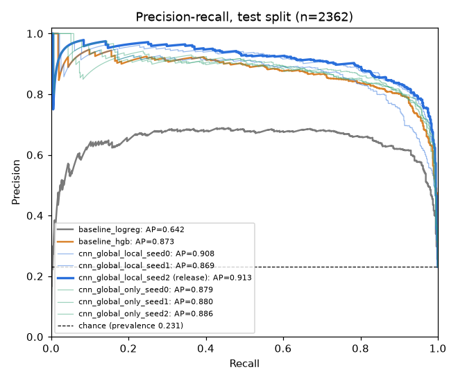
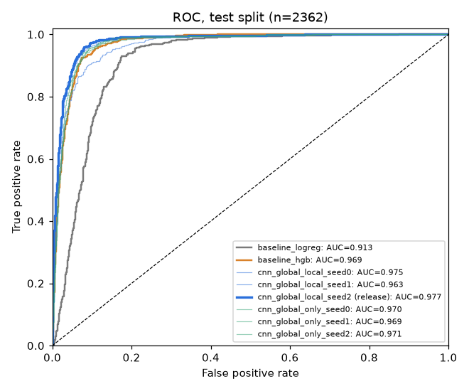
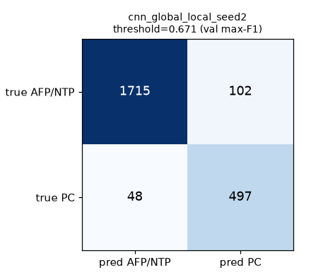
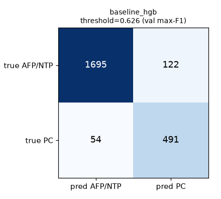
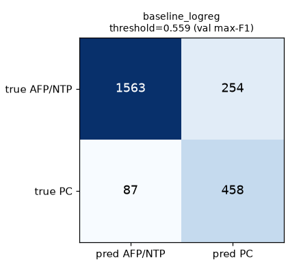
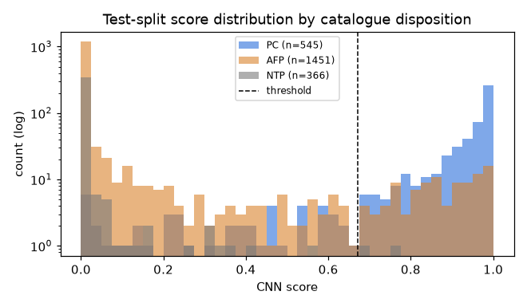
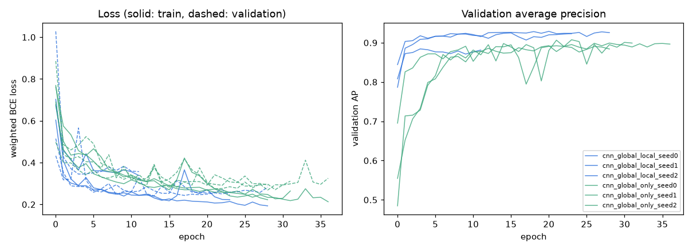

# Results: `full` experiment

Generated by `exofinder evaluate` on 2026-11-18T17:27:38+00:00. Every number below is computed from `reports/full/predictions.csv.gz`; thresholds come from the validation split only.

## Data

| split | examples | stars | PC (1) | AFP+NTP (0) | prevalence |
|---|---|---|---|---|---|
| demo_holdout | 1 | 1 | 1 | 0 | 1.000 |
| test | 2362 | 1481 | 545 | 1817 | 0.231 |
| train | 11010 | 6900 | 2518 | 8492 | 0.229 |
| val | 2360 | 1479 | 536 | 1824 | 0.227 |

Usable examples: 15733 of 15737 selected (9861 stars). Exclusions: `{"insufficient_transit_coverage": 1, "low_global_coverage": 1, "low_local_coverage": 2}`.

## Test-split metrics (identical examples for every model)

| model | AP | ROC-AUC | threshold | precision | recall | F1 | accuracy | TP | FP | TN | FN |
|---|---|---|---|---|---|---|---|---|---|---|---|
| baseline_logreg | 0.642 | 0.913 | 0.559 | 0.643 | 0.840 | 0.729 | 0.856 | 458 | 254 | 1563 | 87 |
| baseline_hgb | 0.873 | 0.969 | 0.626 | 0.801 | 0.901 | 0.848 | 0.925 | 491 | 122 | 1695 | 54 |
| cnn_global_local_seed0 | 0.908 | 0.975 | 0.730 | 0.847 | 0.875 | 0.861 | 0.935 | 477 | 86 | 1731 | 68 |
| cnn_global_local_seed1 | 0.869 | 0.963 | 0.602 | 0.826 | 0.818 | 0.822 | 0.918 | 446 | 94 | 1723 | 99 |
| cnn_global_local_seed2 **(release)** | 0.913 | 0.977 | 0.671 | 0.830 | 0.912 | 0.869 | 0.936 | 497 | 102 | 1715 | 48 |
| cnn_global_only_seed0 | 0.879 | 0.970 | 0.536 | 0.798 | 0.912 | 0.851 | 0.926 | 497 | 126 | 1691 | 48 |
| cnn_global_only_seed1 | 0.880 | 0.969 | 0.492 | 0.782 | 0.927 | 0.848 | 0.923 | 505 | 141 | 1676 | 40 |
| cnn_global_only_seed2 | 0.886 | 0.971 | 0.734 | 0.802 | 0.906 | 0.851 | 0.927 | 494 | 122 | 1695 | 51 |

Test prevalence is 0.231 (545 PC of 2362). A classifier that always predicts AFP/NTP would score accuracy 0.769 with zero recall, and a random ranking has expected AP ≈ 0.231. That is why AP and the PR curve are the primary metrics.

## Variation across CNN training seeds (fixed split)

| variant | runs | AP mean ± sd | ROC-AUC mean ± sd | F1 mean ± sd |
|---|---|---|---|---|
| global_local | 3 | 0.897 ± 0.024 | 0.972 ± 0.008 | 0.851 ± 0.025 |
| global_only | 3 | 0.882 ± 0.004 | 0.970 ± 0.001 | 0.850 ± 0.002 |

## Uncertainty (star-level bootstrap of the test split, 1000 resamples)

- cnn_global_local_seed2: AP 95% interval [0.886, 0.939]
- baseline_hgb: AP 95% interval [0.836, 0.905]
- baseline_logreg: AP 95% interval [0.595, 0.695]
- AP difference cnn_global_local_seed2 − baseline_hgb: mean +0.041, 95% interval [+0.013, +0.070]

## Subgroups (test split)

Tercile edges are computed on the training split. AP is shown only when a subgroup has ≥30 examples and ≥5 of each class.

### cnn_global_local_seed2

| group | value | n | PC | AFP+NTP | AP | recall | FPR |
|---|---|---|---|---|---|---|---|
| Measured transit depth (ppm) | < 166 | 760 | 97 | 663 | 0.878 | 0.876 | 0.032 |
| Measured transit depth (ppm) | 166 - 662 | 840 | 250 | 590 | 0.925 | 0.944 | 0.075 |
| Measured transit depth (ppm) | >= 662 | 762 | 198 | 564 | 0.908 | 0.889 | 0.066 |
| Duration (hours) | < 2.42 | 770 | 140 | 630 | 0.868 | 0.829 | 0.041 |
| Duration (hours) | 2.42 - 4.81 | 788 | 255 | 533 | 0.934 | 0.937 | 0.083 |
| Duration (hours) | >= 4.81 | 804 | 150 | 654 | 0.919 | 0.947 | 0.049 |
| Measured SNR | < 18.8 | 817 | 89 | 728 | 0.850 | 0.820 | 0.027 |
| Measured SNR | 18.8 - 48.5 | 752 | 265 | 487 | 0.927 | 0.955 | 0.092 |
| Measured SNR | >= 48.5 | 793 | 191 | 602 | 0.917 | 0.895 | 0.061 |
| Catalogue disposition | AFP | 1451 | 0 | 1451 | n/a | n/a | 0.069 |
| Catalogue disposition | NTP | 366 | 0 | 366 | n/a | n/a | 0.005 |
| Catalogue disposition | PC | 545 | 545 | 0 | n/a | 0.912 | n/a |

### baseline_hgb

| group | value | n | PC | AFP+NTP | AP | recall | FPR |
|---|---|---|---|---|---|---|---|
| Measured transit depth (ppm) | < 166 | 760 | 97 | 663 | 0.891 | 0.856 | 0.030 |
| Measured transit depth (ppm) | 166 - 662 | 840 | 250 | 590 | 0.902 | 0.948 | 0.103 |
| Measured transit depth (ppm) | >= 662 | 762 | 198 | 564 | 0.831 | 0.864 | 0.073 |
| Duration (hours) | < 2.42 | 770 | 140 | 630 | 0.821 | 0.864 | 0.065 |
| Duration (hours) | 2.42 - 4.81 | 788 | 255 | 533 | 0.894 | 0.918 | 0.094 |
| Duration (hours) | >= 4.81 | 804 | 150 | 654 | 0.875 | 0.907 | 0.047 |
| Measured SNR | < 18.8 | 817 | 89 | 728 | 0.781 | 0.798 | 0.030 |
| Measured SNR | 18.8 - 48.5 | 752 | 265 | 487 | 0.894 | 0.943 | 0.115 |
| Measured SNR | >= 48.5 | 793 | 191 | 602 | 0.874 | 0.890 | 0.073 |
| Catalogue disposition | AFP | 1451 | 0 | 1451 | n/a | n/a | 0.084 |
| Catalogue disposition | NTP | 366 | 0 | 366 | n/a | n/a | 0.000 |
| Catalogue disposition | PC | 545 | 545 | 0 | n/a | 0.901 | n/a |

## Error analysis examples (release model, test split)

Chosen by fixed rules: the 2 highest-scoring true positives; the lowest-scoring correctly rejected AFP and NTP; the 2 highest-scoring false-positive AFPs and the highest-scoring false-positive NTP; the 3 lowest-scoring false negatives; the 2 examples closest to the threshold.

| category | TCE | disposition | score | period (d) | duration (h) | depth (ppm) | SNR |
|---|---|---|---|---|---|---|---|
| true positive: highest-scoring PC | 011342416_01 | PC | 1.000 | 25.369 | 4.65 | 110 | 26.5 |
| true positive: highest-scoring PC | 007898352_02 | PC | 0.999 | 30.184 | 5.97 | 966 | 45.0 |
| true negative: lowest-scoring AFP | 002445134_02 | AFP | 0.000 | 8.412 | 5.14 | 7185 | 1358.3 |
| true negative: lowest-scoring NTP | 004678875_02 | NTP | 0.000 | 0.626 | 2.02 | 11474 | 59.2 |
| false positive: highest-scoring AFP | 010587105_03 | AFP | 0.999 | 35.866 | 6.89 | 270 | 32.8 |
| false positive: highest-scoring AFP | 010470206_01 | AFP | 0.996 | 46.567 | 7.70 | 824 | 139.5 |
| false positive: highest-scoring NTP | 008231830_01 | NTP | 0.771 | 6.919 | 1.60 | 55 | 11.5 |
| false negative: lowest-scoring PC | 008822421_01 | PC | 0.000 | 1.645 | 1.81 | 3946 | 9.5 |
| false negative: lowest-scoring PC | 009047416_01 | PC | 0.000 | 9.015 | 3.21 | 891 | 6.5 |
| false negative: lowest-scoring PC | 005785279_01 | PC | 0.000 | 0.909 | 1.36 | 66 | 11.3 |
| borderline: closest to threshold | 006611330_01 | PC | 0.676 | 35.146 | 2.19 | 6972 | 144.5 |
| borderline: closest to threshold | 010352333_01 | PC | 0.676 | 1.571 | 0.77 | 369 | 7.6 |

## Demonstration hold-out (Kepler-90, never used for training, validation or the benchmark)

| TCE | model | catalogue disposition | score | threshold | above threshold |
|---|---|---|---|---|---|
| 011442793_01 | baseline_logreg | PC | 0.923 | 0.559 | True |
| 011442793_01 | baseline_hgb | PC | 0.523 | 0.626 | False |
| 011442793_01 | cnn_global_local_seed0 | PC | 0.987 | 0.730 | True |
| 011442793_01 | cnn_global_local_seed1 | PC | 0.941 | 0.602 | True |
| 011442793_01 | cnn_global_local_seed2 | PC | 0.982 | 0.671 | True |
| 011442793_01 | cnn_global_only_seed0 | PC | 0.017 | 0.536 | False |
| 011442793_01 | cnn_global_only_seed1 | PC | 0.490 | 0.492 | False |
| 011442793_01 | cnn_global_only_seed2 | PC | 0.810 | 0.734 | True |

## Figures

